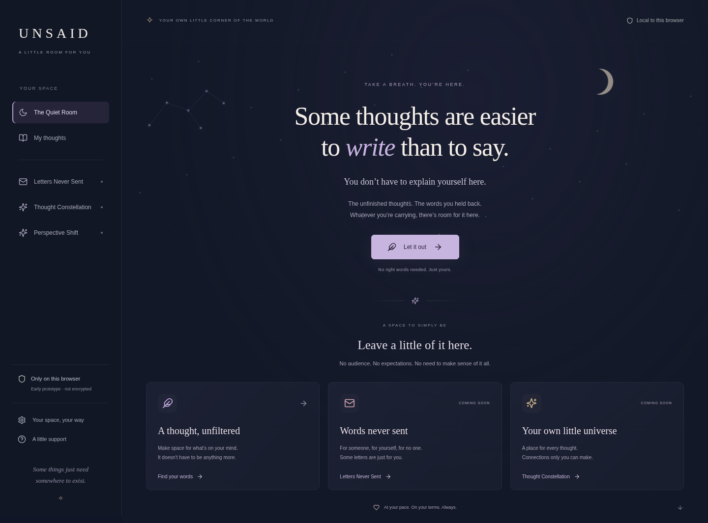
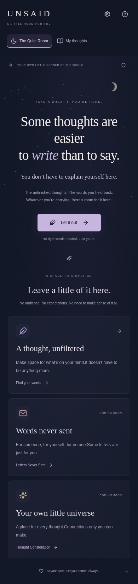
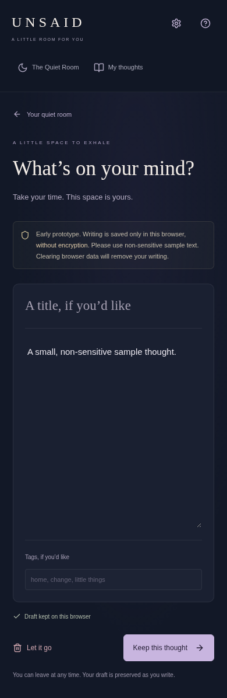

# UNSAID

**Some thoughts are easier to write than to say.**

A calm, account-free writing space for adults who want somewhere to leave unfinished thoughts, without an audience, scores or expectations. A reflection product, not therapy or emergency support.

## Current scope

Phase 1 and Phase 2: responsive quiet room, navigation, free-form editor, optional titles/tags, automatic single-draft preservation, manual save, persisted thought collection, search, reading, editing and confirmed deletion. Decorative motion is optional and respects reduced motion. Later spaces have honest coming-soon screens.

**This prototype stores writing in plaintext. Use non-sensitive sample text only.** No encryption, privacy lock, backup import/export, letters, interactive constellation, reflection prompts or full timeline is implemented. No accounts, analytics, external AI, advertisements, external fonts or writing server are included.

## Run locally

Node 22+ (validated on Node 24) and npm are required.

```sh
npm ci --cache /tmp/unsaid-npm-cache
npm run dev
```

Open the address Vite prints. Keep the same origin to access the same browser storage. For production, run `npm run build` and serve `dist` with an SPA fallback. `npm run preview` serves the built application for local checks.

## Validation

```sh
npm test
npm run build
npm run lint
npm run format:check
npx playwright install chromium
npm run test:e2e
```

Playwright starts Vite automatically. Browser installation may require an allowed download host and system libraries. Tests cover storage transactions, validation, draft persistence, edit/delete behavior, component navigation, real-browser reload, search, confirmation, mobile layout and keyboard entry. These tests do not certify security or WCAG compliance.

## Architecture and decisions

React + strict TypeScript + Vite; Tailwind CSS and custom tokens; Motion for optional transitions; IndexedDB via idb; React Router; bundled Lucide icons. Minimal phase-specific dependencies; no graph or cryptography dependency until those features are built. See [architecture](docs/architecture.md) for dependency purposes and storage design.

- [Implementation plan](docs/implementation_plan.md)
- [Product vision](docs/product_vision.md)
- [Privacy model and limitations](docs/privacy_model.md)
- [Design system](docs/design_system.md)
- [Roadmap](docs/roadmap.md)
- [Product case study](docs/case_study.md)

## Limitations

Only one draft is supported; simultaneous tabs can overwrite changes. The latest uncommitted write may be lost on abrupt close. Browser clearing or eviction can remove data. There is no backup, authentication or encryption. Shared profiles, extensions or compromised software can expose writing. Application deletion cannot guarantee forensic erasure. A full accessibility and security review remains outstanding.

## Real application screenshots







In this cloud environment, Chromium is already installed. Use `PLAYWRIGHT_CHROMIUM_EXECUTABLE_PATH=/usr/bin/chromium npm run test:e2e` to reuse it without downloading another browser.
