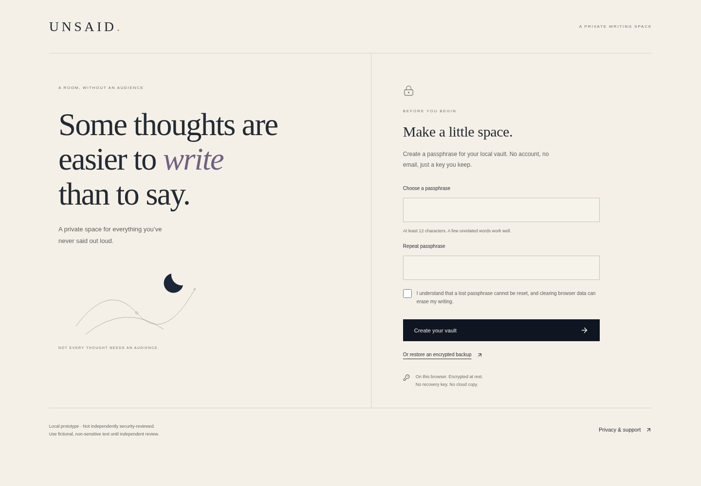
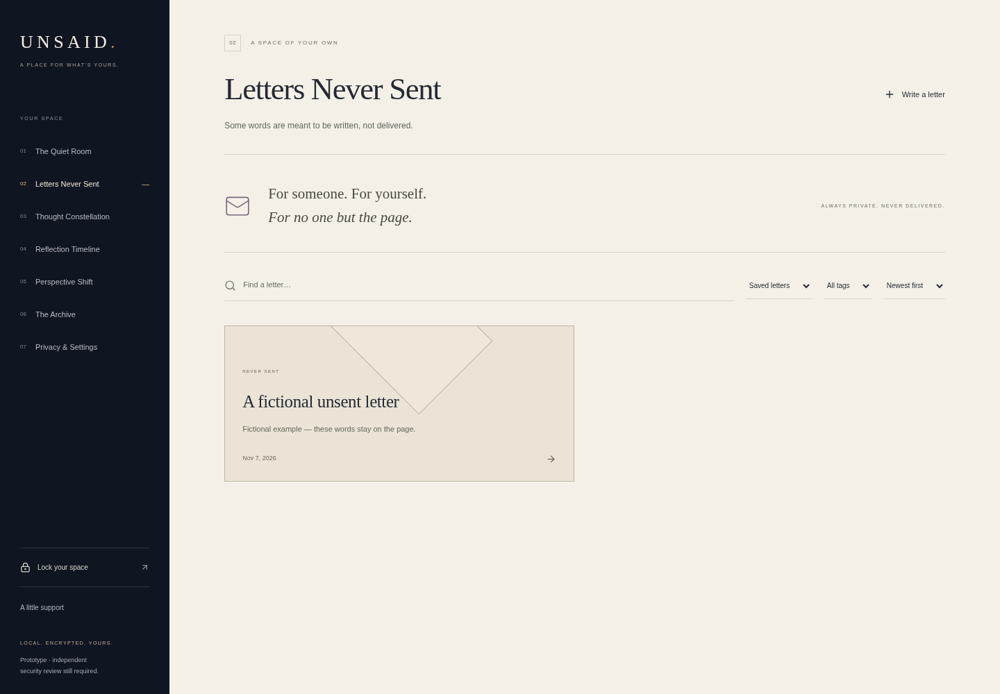
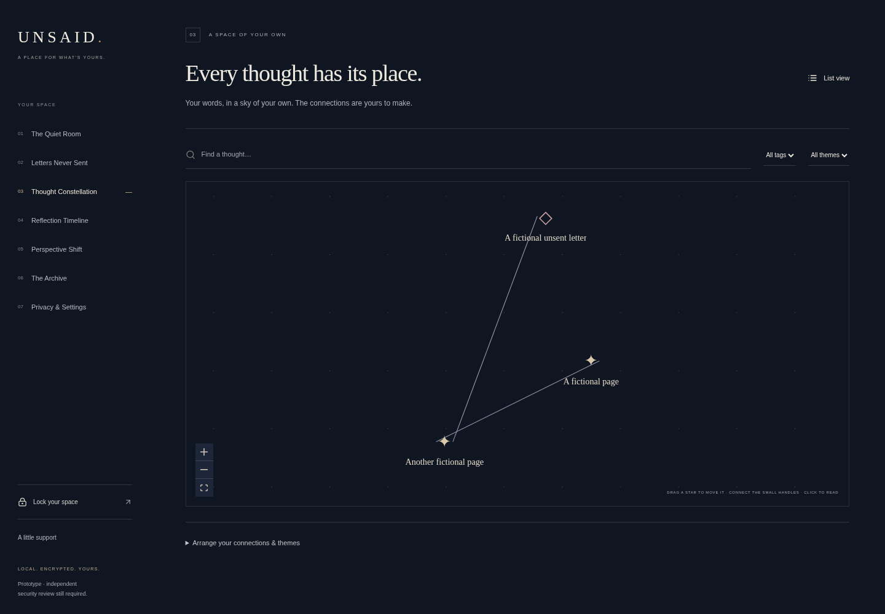

# UNSAID

**Some thoughts are easier to write than to say.**

A local-first writing space for adults: no account, no audience, no scores, and no expectation to turn every feeling into progress. UNSAID is for personal reflection, not therapy or emergency response.

> **Encrypted local prototype, not independently security-reviewed. Use fictional, non-sensitive content until the encryption and data-handling controls have been independently reviewed. Encryption does not provide absolute secrecy.**

## The experience

- **The Quiet Room:** a quiet entry point and warm-paper editor. Optional title and tags, encrypted draft preservation, manual save, editing, confirmed deletion, and Cmd/Ctrl+S. Failed saves remain visible and trigger navigation/close protection.
- **Letters Never Sent:** optional openings, encrypted drafts, a restrained envelope interaction, a letter collection, search, editing, deletion, and encrypted selected-letter export. There is no sending functionality or recipient collection.
- **Thought Constellation:** real writing becomes draggable stars. Pan, zoom, open entries, manually connect/disconnect them, name themes, search and filter. Positions, themes, and relationships are encrypted. A list and forms provide alternatives to spatial interactions.
- **Reflection Timeline:** chronological writing, month/year selection, tag/type filters and search. Open, edit, delete, or voluntarily reflect on writing. No mood scores or automatic memory resurfacing.
- **Perspective Shift:** three optional perspectives, nine static questions, encrypted response drafts and saved reflections linked to their source writing. No AI or text analysis.
- **The Archive:** saved thoughts, letters, reflections and drafts; search, tags, type filters, sorting, reading, editing, deletion, and encrypted whole-vault export.
- **Privacy & Settings:** create/unlock/lock, inactivity locking, passphrase changes, backup import/export, explicit plaintext migration, clear-all controls and motion preferences. Support resources are available both locked and unlocked.

## Run locally

Node 22+ and npm. Validated with Node 24.

```sh
npm ci --cache /tmp/unsaid-npm-cache
npm run dev
```

Open the address printed by Vite. Create a passphrase of at least 12 characters and acknowledge the recovery limitation. On reload, the vault is locked. There is no email, recovery key, password reset, or cloud copy.

Browser storage belongs to the exact **origin and browser profile**. Switching device, port, protocol, or browser does not transfer writing. Use an encrypted backup to transfer a vault. Keep its passphrase separately. Avoid simultaneous editing tabs.

```sh
npm run build
npm run preview
```

Production hosting must serve `dist`, use HTTPS, and fall back to `index.html` for application routes. Web Crypto requires a secure context (HTTPS or a browser-trusted localhost origin). Do not deploy for real sensitive use before independent review. The development server and its hot reload tooling are for development, not a hardened deployment.

## Tests and quality checks

```sh
npm test
npm run build
npm run lint
npm run format:check
npx playwright install chromium
npm run test:e2e
```

In this cloud image, reuse installed Chromium:

```sh
PLAYWRIGHT_CHROMIUM_EXECUTABLE_PATH=/usr/bin/chromium npm run test:e2e
```

Tests use clearly fictional text. Vitest covers authenticated encryption, wrong keys and tampering, fresh salts/nonces, encrypted drafts, session locking, write serialization and stale-tab rejection, passphrase changes, backups, migration and graph/reflection integrity. Playwright exercises real browser flows, mobile layouts, keyboard dialogs, reduced motion, failed-write protection, and automated axe accessibility checks. A representative workflow checks outbound requests. See [validation](docs/validation.md) for actual results and their limits. Passing tests are not a security audit or a WCAG certification.

## Privacy architecture

The whole versioned collection is encrypted with **AES-256-GCM**, including titles, bodies, tags, drafts, reflection prompts/responses, graph metadata and timestamps. A **PBKDF2-HMAC-SHA256** key derivation uses **600,000 iterations**, a fresh random 16-byte salt for each new key, and a fresh random 12-byte nonce for each encryption. Keys are non-extractable and held in memory only. The app does not persist passphrases or decrypted content in localStorage/IndexedDB. Only motion/idle preferences are plaintext localStorage settings.

One authenticated envelope lives in IndexedDB `unsaid-encrypted`. Updates serialize and compare the stored revision in an atomic transaction; stale tabs cannot silently overwrite newer state. The graph library is loaded only when its screen opens. No writing is submitted to a server, AI, analytics system, or text-processing service. Fonts are system fonts; illustrations are local CSS/SVG.

## Earlier prototype data

The old `unsaid-writing` database is inspected locally on startup. **It is never silently migrated or deleted.** If earlier records exist, setup offers an explicit migration choice; Privacy & Settings also provides migration. Records and the unfinished draft are first saved into the encrypted vault. Only after that succeeds does a separate transaction compare and clear the earlier records. A changed legacy database refuses cleanup. Migration markers make a retry idempotent for unchanged records. Close older app tabs before migration. If declined, old plaintext remains until explicitly migrated or cleared, and the interface calls this out.

## Limitations

- No independent security review has been performed. Device compromise, malicious extensions, injected code, or access to an unlocked screen can expose writing.
- No forensic deletion guarantee; old backups, storage remnants and screenshots may retain writing. Old backup files keep their original passphrase after a passphrase change.
- Browser clearing/eviction can lose the vault. No server backup or recovery exists.
- The prototype rewrites the encrypted collection per change, with a 20 MB document limit. It is intended for modest local collections, not large archives or attachments.
- Stale writes are rejected, not merged. Lock/unlock to reload current state; explicitly discard or copy failed changes first.
- Inactivity timers can be delayed by browser suspension. An unresolved save failure prevents automatic locking to avoid silently discarding writing; lock manually with explicit discard after copying it if necessary.
- Plaintext migration spans two databases and cannot be atomic across them. Source cleanup can fail after encrypted saving; the UI reports this and supports retry.
- No installable offline app/service worker. The application assets must be served; storage is local once loaded.
- Automated accessibility checks complement, but do not replace, manual assistive-technology review. Chromium was tested; other engines need compatibility validation.

## Actual application







## Project notes

- [Product vision](docs/product_vision.md)
- [Architecture and dependency purposes](docs/architecture.md)
- [Design system](docs/design_system.md)
- [Privacy model](docs/privacy_model.md)
- [Security threat model](docs/security_threat_model.md)
- [Product case study](docs/product_case_study.md)
- [Implementation and acceptance evidence](docs/implementation_plan.md)
- [Roadmap](docs/roadmap.md)
